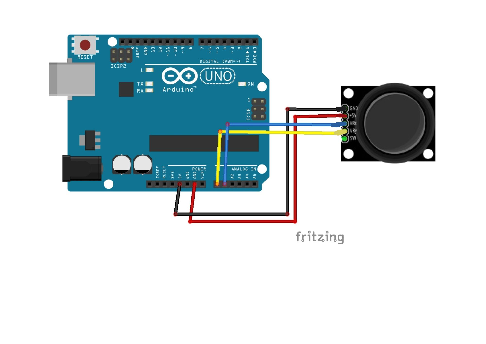

# Joytick_Arduino_Project

## Overview

In this project, you will see how to use a joystick. You will need to an Arduino UNO, a joystick, and a breadboard. 
The arduino will scan the joystick position every time and will print it in the Serial Monitor.

## Components Used

- Arduino UNO
- Breadboard
- Joystick
- wires

## Wiring Diagram

See the image above for the complete wiring schematic.

## Installation

1. Assemble the circuit as shown in the wiring diagram.
2. Download this repository.
3. Install the Arduino IDE from [arduino.cc](https://www.arduino.cc/en/software).
4. Connect the Arduino UNO to your PC via USB.

## Usage

1. Upload the Arduino code to your board.
2. Power the circuit.
3. Try to move the joystick and see the serial monitor.

## Example Arduino Sketch

Check the code in the file: Joystick/Joysick.ino

## Dependencies

- Arduino IDE

## Credits

Wiring diagram created with Fritzing.
